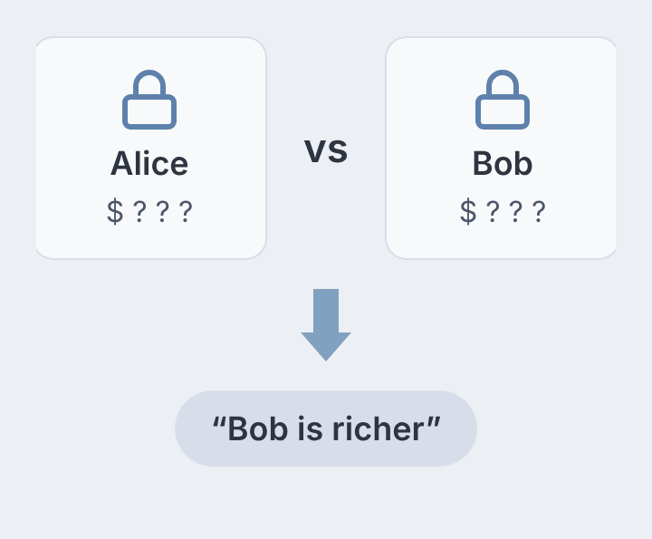
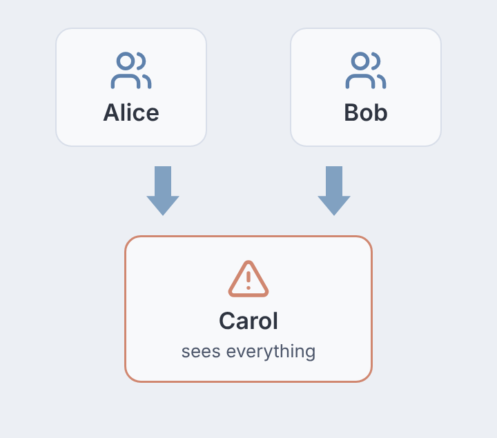
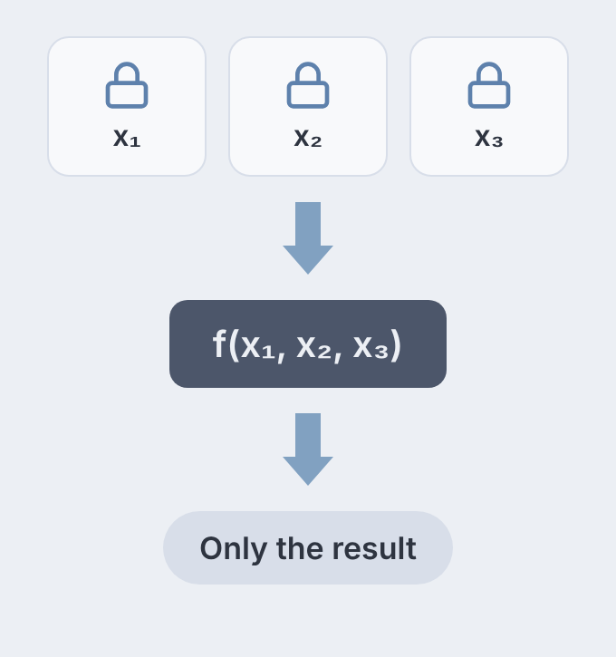

In 1982 Andrew Yao proposed an interesting thought experiment.  This experiment, known as the **Millionaires Problem** ([Yao82](https://en.wikipedia.org/wiki/Yao%27s_Millionaires%27_problem)), would go on to motivate the development of many different approaches to privacy-preserving computation.  The Millionaire's Problem itself is rather simple; given two millionaires, Alice and Bob, can they determine who is richer without revealing their actual wealth to each other.

Naturally, both Alice and Bob will both learn something from the result, i.e., who has more money, but they shouldn't learn anything beyond what is revealed by the outcome of the comparison.

  

A straightforward approach to the Millionaire's problem is to introduce a trusted party, Carol, who can compute the computation on behalf of Alice and Bob.  In this scenario, Alice and Bob each whisper a number to Carol who then announces the wealthier individual.  This strategy can work, and in some sense embodies many of the systems and trust assumptions in use today.  For example, many cloud computing services operate under a similar model.  Users outsource computation to a cloud provider, trusting the provider to process their data correctly while maintaining the data's confidentiality. 

  

Andrew Yao, however, was hinting at a different model of computation -- one where we don't need to trust a third party.  In Yao's mind, Alice and Bob could determine who was wealthier without having to trust each other or anyone else.  This is the idea behind Secure Multi-Party Computation (MPC).

An MPC computation consists of two or more parties holding private inputs.  Together, these parties compute a function on their inputs.  This function can be as simple as a sum, or as complex as a machine learning inference.  Regardless of the computation, all that should be learned by all the parties is the output, and whatever can be inferred from that output.  There is no inherent need for a trusted third party, because the protocol itself plays the role of the third party.   

  

As a motivating example for the usefulness of such a protocol, consider the field of genomics. Genomic data is inherently sensitive, as an individual's genetic makeup can reveal a great deal about their health, predispositions to disease, and other personal characteristics. Genome-wide association studies (GWAS), for example, analyze genetic data across populations to identify associations between genetic variations and observable traits or diseases ([NIH](https://www.genome.gov/genetics-glossary/Genome-Wide-Association-Studies-GWAS)). These findings can help researchers better understand disease mechanisms, identify risk factors, and develop new treatments.

Conducting these studies, however, often requires access to large datasets collected across multiple hospitals and research institutions. Because genomic data is highly sensitive and subject to privacy regulations such as HIPAA, institutions may be reluctant to share their raw patient data with one another, making it difficult to assemble sufficiently large datasets for meaningful analysis.

Multi-party computation (MPC) offers a potential solution to this problem by allowing institutions to collaboratively perform these analyses without revealing their underlying data ([ThriftyMPC](https://eprint.iacr.org/2026/977.pdf)). Specifically, MPC enables institutions to (1) keep their raw genomic data private, (2) jointly compute analyses using inputs held by multiple parties, and (3) perform these computations without requiring a trusted third party to access their data.

In the next part of this series, we will explore how to build MPC primitives through variations of secret sharing.  Stay tuned...
